<picture>
  <source media="(prefers-color-scheme: dark)" srcset="assets/masthead-dark.svg">
  
</picture>

  <a href="mailto:dev.kumarharshraj@gmail.com">Email</a> &nbsp;·&nbsp;
  <a href="https://www.linkedin.com/in/kumar-harsh-raj">LinkedIn</a> &nbsp;·&nbsp;
  <a href="https://leetcode.com/u/Harsh_01815/">LeetCode</a>

### About

I like owning a feature from end to end — the Compose screen, the API it calls, and the table underneath it.

As an SDE intern at **Fin Tradify** I worked on two production Android apps on Google Play: twelve Compose screens, eighteen API integrations, an offline-first data layer with Room, and about 15% fewer crashes by the time I left. These days I lead the development team at **CSI VIT-AP**, where our app, [CSI Events](https://github.com/Harsh181507/CSIeventsApp), runs the chapter's hackathons.

### History

<picture>
  <source media="(prefers-color-scheme: dark)" srcset="assets/history-dark.svg">
  
</picture>

### Selected work

| Project | What it is | Built with |
|---|---|---|
| **[CSI Events](https://github.com/Harsh181507/CSIeventsApp)** · [API](https://github.com/Harsh181507/csieventmangement) | The event app CSI VIT-AP runs its hackathons on: teams join with a code, judges score from their phones, results go live when the organizer publishes them. | Kotlin, Compose, Spring Boot, PostgreSQL |
| **[Patient Management](https://github.com/Harsh181507/patient-management-microservices)** | Five Spring Boot services behind a JWT gateway. Kafka carries events to analytics, billing talks gRPC, and AWS CDK deploys it all to ECS Fargate. | Spring Cloud, Kafka, gRPC, AWS |
| **[Fact Knowledge Layer](https://github.com/Harsh181507/fact-knowledge-layer)** | Reads PDFs, pulls out facts with an LLM along with the exact quote behind each one, and flags where documents agree or contradict. | Java, LLM |
| **[Order & Position Engine](https://github.com/Harsh181507/indo-thai-order-position)** | Two services for streaming orders and real-time net positions — idempotent, throttled and safe under concurrency. | Spring Boot |
| **[Tomato](https://github.com/Harsh181507/Tomato-Hackathon)** | A food-delivery platform built at a hackathon: Android app and backend in one push. | Kotlin, Compose, Spring Boot |

### Toolbox

**Android** — Kotlin, Jetpack Compose, MVVM, Hilt, Retrofit, Room, Coroutines and Flow, Firebase 
**Backend** — Java, Spring Boot, Spring Cloud Gateway, Spring Security, Kafka, gRPC, PostgreSQL 
**Cloud** — AWS (CDK, ECS Fargate, RDS, MSK), Docker, Kubernetes, GitHub Actions, LocalStack 
**Practice** — clean architecture, REST and event-driven design, code review, JUnit

### Activity

<picture>
  <source media="(prefers-color-scheme: dark)" srcset="https://github-readme-stats.vercel.app/api?username=Harsh181507&show_icons=true&hide_border=true&bg_color=0F1115&title_color=ECEAE4&icon_color=FF6B45&text_color=A3A1A8&ring_color=FF6B45">
  
</picture>
<picture>
  <source media="(prefers-color-scheme: dark)" srcset="https://streak-stats.demolab.com?user=Harsh181507&hide_border=true&background=0F1115&ring=FF6B45&fire=FF6B45&currStreakNum=ECEAE4&sideNums=ECEAE4&currStreakLabel=FF6B45&sideLabels=A3A1A8&dates=6C6B73&stroke=262830">
  
</picture>

<picture>
  <source media="(prefers-color-scheme: dark)" srcset="https://raw.githubusercontent.com/Harsh181507/Harsh181507/output/snake-dark.svg">
  
</picture>
